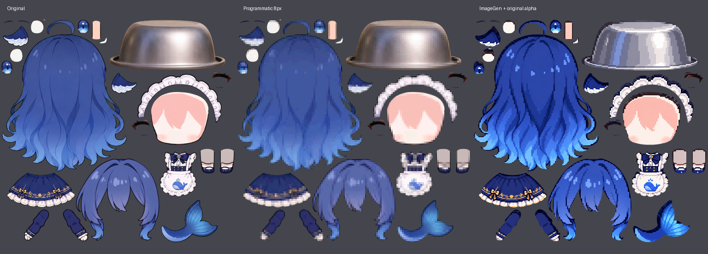

<div align="center">

# L2D Library

Live2D 模型、VTube Studio 运行资源与纹理实验集

[](#模型目录)
[](#安装到-vtube-studio)
[](#获取模型)
[](LICENSE)

[模型目录](#模型目录) · [获取模型](#获取模型) · [安装使用](#安装到-vtube-studio) · [纹理实验](#像素化纹理) · [问题反馈](https://github.com/Xnmk029/L2D_library/issues)

</div>

## 项目介绍

L2D Library 收录奶鲸 V1、俱往矣铁盆鲸鱼、铁盆、O小狗和刚的门五个模型目录，保留模型二进制、纹理、物理、VTube Studio 配置及随包资料，方便下载、使用和版本归档。

奶鲸 V1 提供完整运行包及表情、动作和 VBridger 配置；俱往矣铁盆鲸鱼附带程序化和 ImageGen 像素化纹理；铁盆、O小狗和刚的门作为独立 Live2D 模型保存，各含 1 张纹理、物理与 VTS 配置，并附带模型缩略图。

这里收录的是运行资源。奶鲸说明中提及的独立 `.psd2live` 原生工程未包含在本仓库内。

## 模型目录

| 模型 | 仓库目录 | 模型入口 | 主要内容 |
| --- | --- | --- | --- |
| 奶鲸 V1 | [NaiJing_V1_VTS_Full_20261014](NaiJing_V1_VTS_Full_20261014/) | `NaiJing_V1_Full_20261014/psd2live-preview.model3.json` | 27 张引用纹理、44 份表情、4 份动作文件、物理与 VBridger 配置 |
| 俱往矣铁盆鲸鱼 | [俱往矣铁盆鲸鱼](俱往矣铁盆鲸鱼/) | `俱往矣鲸鱼.model3.json` | 2 张默认纹理、物理、VTS 配置、表情文件及像素化纹理实验 |
| 铁盆 | [铁盆](铁盆/) | `铁盆.model3.json` | 独立模型、1 张纹理、物理及 VTS 配置 |
| O小狗 | [O小狗](O小狗/) | `O小狗.model3.json` | 独立模型、1 张纹理、1 份表情、物理、VTS 配置与模型缩略图 |
| 刚的门 | [刚的门](刚的门/) | `刚的门.model3.json` | 独立模型、1 张纹理、2 份表情、物理、VTS 配置与模型缩略图 |

原有三个目录按 2026-10-14 的本地文件快照收录，O小狗与刚的门按 2026-10-16 的快照收录，合计 153 个文件，约 196 MiB。奶鲸包的详细版本与文件清单见 [VERSION_MANIFEST.json](NaiJing_V1_VTS_Full_20261014/VERSION_MANIFEST.json) 和 [RUNTIME_MANIFEST.json](NaiJing_V1_VTS_Full_20261014/RUNTIME_MANIFEST.json)。

## 获取模型

### 克隆仓库

请先安装 [Git](https://git-scm.com/downloads) 和 [Git LFS](https://git-lfs.com/)，再执行：

```bash
git lfs install
git clone https://github.com/Xnmk029/L2D_library.git
cd L2D_library
git lfs pull
```

仓库通过 Git LFS 存储 `.moc3` 文件。奶鲸 V1 的模型二进制为 176,535,680 字节，完整下载后才可加载模型。

### 已经下载了仓库

在仓库目录内执行：

```bash
git pull --ff-only
git lfs pull
```

GitHub 的 **Download ZIP** 是否包含实际 LFS 文件取决于仓库的归档设置。如果解压后的 `.moc3` 只有几行文本，且以 `version https://git-lfs.github.com/spec/v1` 开头，得到的是指针文件，请使用上面的克隆方法获取完整资源。详见 [GitHub 的 LFS 归档说明](https://docs.github.com/en/repositories/managing-your-repositorys-settings-and-features/managing-repository-settings/managing-git-lfs-objects-in-archives-of-your-repository)。

## 安装到 VTube Studio

### 1. 找到模型目录

Windows Steam 版的目录结构为：

```text
<SteamLibrary>/steamapps/common/VTube Studio/
└── VTube Studio_Data/StreamingAssets/Live2DModels/
```

也可以在 VTube Studio 内打开模型文件夹。安装方法可参考 [VTube Studio 官方说明](https://github.com/DenchiSoft/VTubeStudio/wiki/Loading-your-own-Models)。

### 2. 复制实际模型文件夹

| 要使用的模型 | 应复制到 `Live2DModels` 的目录 |
| --- | --- |
| 奶鲸 V1 | `NaiJing_V1_VTS_Full_20261014/NaiJing_V1_Full_20261014` |
| 俱往矣铁盆鲸鱼 | `俱往矣铁盆鲸鱼` |
| 铁盆 | `铁盆` |
| O小狗 | `O小狗` |
| 刚的门 | `刚的门` |

奶鲸的外层目录是交付包，模型入口位于内层 `NaiJing_V1_Full_20261014`。复制时保留内层目录及全部资源。

例如，将全部模型安装到 D 盘的 VTube Studio，在本仓库根目录执行以下 PowerShell 命令：

```powershell
$vtsModels = 'D:\SteamLibrary\steamapps\common\VTube Studio\VTube Studio_Data\StreamingAssets\Live2DModels'

Copy-Item -LiteralPath '.\NaiJing_V1_VTS_Full_20261014\NaiJing_V1_Full_20261014' -Destination $vtsModels -Recurse
Copy-Item -LiteralPath '.\俱往矣铁盆鲸鱼' -Destination $vtsModels -Recurse
Copy-Item -LiteralPath '.\铁盆' -Destination $vtsModels -Recurse
Copy-Item -LiteralPath '.\O小狗' -Destination $vtsModels -Recurse
Copy-Item -LiteralPath '.\刚的门' -Destination $vtsModels -Recurse
```

若已安装同名模型，先备份旧模型目录和自定义设置，再安装更新。奶鲸包保留原 ModelID，避免同时安装多个使用该 ModelID 的副本。

### 3. 加载与校准

启动或重新启动 VTube Studio，在模型选择中加载目标模型，再完成摄像头或手机面捕校准。奶鲸随附的 VBridger 配置位于 `VBridger_Config/`，按自己的面捕设备与参数映射进行设置。

## 奶鲸 V1 使用说明

奶鲸包内保留完整使用资料。首次使用建议阅读 [README_先读我.txt](NaiJing_V1_VTS_Full_20261014/README_先读我.txt)。

### 表情与动作

- 默认保留 44 份原表情，以 `V1_Face_*` 等入口使用；主情绪一次开启一个。
- 牙型一次保留一种，牙型表情的淡入、淡出时间设为 `0`。
- 表情快捷键未预绑定，请在 VTube Studio 中自行指定。
- 默认注册的动作是 `Idle → DizzySpin_2s` 和 `V1_Actions → Body_KneeAlternate_8s`；另两份旋转速度文件作为备选保存。
- 播放轻膝动作前关闭所有 `V1_Pose` 表情，包括 `Neutral`。当前动作峰值为 `0.95`，旧说明中的 `0.5` 已过时。

### 可选表情聚合包

`Extras/` 内附 32 个入口的表情聚合候选包。它属于可选实验内容，默认模型仍保留原 44 表情；候选小文件包依赖完整运行目录，不能单独当作模型安装。

试用前请阅读压缩包内的说明。候选版的 Windows VTube Studio 宿主交互、快速连按和退出恢复尚未验收。

### 验证范围

随包 [VALIDATION.json](NaiJing_V1_VTS_Full_20261014/VALIDATION.json) 记录了文件结构、引用、参数及既有基线检查。此次仓库收录未重新执行 Windows VTube Studio 或 VBridger 实机测试；真人面捕、快捷键和长期性能仍需在实际环境中确认。

## 像素化纹理

俱往矣铁盆鲸鱼的默认模型继续引用原始两张纹理。可选纹理保存在：

```text
俱往矣铁盆鲸鱼/
└── 俱往矣鲸鱼.1024/
    └── pixel_variants_20261008/
```

| 目录 | 效果 | 适用说明 |
| --- | --- | --- |
| `programmatic_light_4px` | 4×4 色块 | 保留较多细节 |
| `programmatic_medium_8px` | 8×8 色块 | 较明显的像素化 |
| `programmatic_strong_16px` | 16×16 色块 | 强烈像素化 |
| `imagegen_alpha_preserved` | ImageGen 重绘后恢复原尺寸与透明度 | 内部纹理可能偏移，需检查模型效果 |
| `imagegen_raw` | 原始生成图 | 修图与风格参考，不能直接替换原尺寸纹理 |

程序化版本保留原尺寸、部件位置和透明度。生成式整理版为 1024×1024，但内部线条并不保证与原 UV 完全对齐。

下图为纹理图集对比，左侧是原图，中间是程序化 8px，右侧是生成式整理版：



应用某一版本时，先备份模型的 `俱往矣鲸鱼.1024/texture_00.png` 和 `texture_01.png`，再用选中目录内的两张同名纹理替换。重新加载模型后查看表情和动作。处理细节见 [纹理说明](俱往矣铁盆鲸鱼/俱往矣鲸鱼.1024/pixel_variants_20261008/README.md)。

## 仓库结构

```text
L2D_library/
├── README.md
├── LICENSE
├── .gitattributes
├── NaiJing_V1_VTS_Full_20261014/
│   ├── README_先读我.txt
│   ├── VERSION_MANIFEST.json
│   ├── RUNTIME_MANIFEST.json
│   ├── VALIDATION.json
│   ├── SHA256SUMS.txt
│   ├── Documents/
│   ├── Extras/
│   └── NaiJing_V1_Full_20261014/
│       ├── psd2live-preview.model3.json
│       ├── psd2live-preview.moc3
│       ├── psd2live-preview.2048/
│       ├── expressions/
│       ├── motions/
│       └── VBridger_Config/
├── 俱往矣铁盆鲸鱼/
│   ├── 俱往矣鲸鱼.model3.json
│   ├── 俱往矣鲸鱼.moc3
│   └── 俱往矣鲸鱼.1024/
├── 铁盆/
│   ├── 铁盆.model3.json
│   ├── 铁盆.moc3
│   └── 铁盆.1024/
├── O小狗/
│   ├── O小狗.model3.json
│   ├── O小狗.moc3
│   └── O小狗.1024/
└── 刚的门/
    ├── 刚的门.model3.json
    ├── 刚的门.moc3
    └── 刚的门.2048/
```

上图展示主要入口；各模型的物理、显示信息、VTS 设置和其他随附文件保留在对应目录中。

## 常见问题

| 现象 | 检查方式 |
| --- | --- |
| 模型加载失败，`.moc3` 体积很小 | 在仓库目录执行 `git lfs pull`，确认取得真实模型二进制 |
| 奶鲸不出现在模型列表 | 确认复制的是内层 `NaiJing_V1_Full_20261014`，其根目录包含 `.model3.json` |
| 奶鲸表情没有快捷键 | 本包未预绑定热键，在 VTS 内自行配置 |
| 替换生成式纹理后局部错位 | 恢复备份，或选择保留布局的程序化纹理版本 |

## 反馈与贡献

欢迎通过 [Issues](https://github.com/Xnmk029/L2D_library/issues) 报告问题，或通过 Pull Request 补充说明、修复配置及提交模型改进。

反馈时请附上模型目录或版本、VTube Studio 版本、面捕方式、复现步骤及相关截图。提交改动时保留相对路径，并说明修改的文件与实际验证范围。

## 许可

仓库沿用已有的 GNU General Public License v3.0，完整条款见 [LICENSE](LICENSE)。

## 相关项目

- [Live2D](https://www.live2d.com/)
- [VTube Studio](https://github.com/DenchiSoft/VTubeStudio)
- [Git LFS](https://git-lfs.com/)
